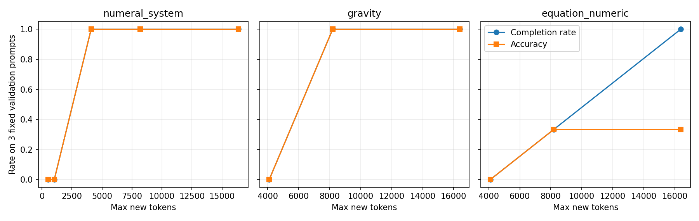
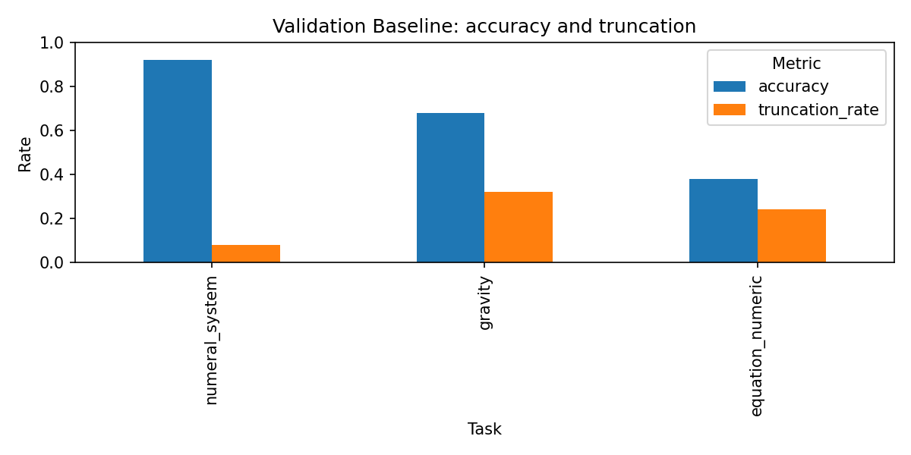

# 三任务替换与 Validation Baseline 实测报告（2026-11-06）

本轮仅替换正式任务、重建版本化数据和执行基座 Baseline。没有修改 02–06 的训练算法、Reward、模型或 LoRA/QLoRA 配置；原有未提交工作保留。Bit 只作为高级扩展和历史实验保留。

## 数据与独立验证

|任务|难度|Train|Validation|Holdout Test|合计|
|---|---|---:|---:|---:|---:|
|numeral_system|easy|1260|158|158|1576|
|gravity|medium|1277|160|160|1597|
|equation_numeric|hard|586|73|73|732|

原始 CSV：9500 行，SHA256 `d204af160633b638448723a437aa51c0db70fd0b64ff92f6ad6f52e5ac6377fa`。种子 42，按任务做 80/10/10 IID 划分，Validation/Test 各四舍五入到整数；程序重新计算数量，没有按历史数量筛选。原 CSV、旧 splits、旧 Pilot 和历史 GPU 结果均未覆盖。

Roman 的 6,222 个示例映射和 1,576 个目标答案均通过规范语法及独立减法求值验证，真实范围为 1–100。另通过 1–3999 穷举往返、14 个非法/错值负样本、8 个 schema 边界用例。Encoder 使用按位值表；Verifier 不调用 Encoder 或 Solver。

答案完成状态统一使用 `official_nvidia_metric_v3`：`finish_reason=length` 无论 Thinking 中是否出现正确值都不计正确。数值保留 `math.isclose(rel_tol=1e-2, abs_tol=1e-5)`；Equation 的 44 个带符号前后缀答案保留精确字符串语义，不能删掉运算符。格式回归覆盖嵌套 LaTeX、字面符号和截断。

## 泄漏审计及解释边界

跨集合 ID、精确 Prompt、规范化 Prompt 重复均为 0。规范化保留数值与运算符；结构指纹用于观察模板相似，不是同源判据。
结构指纹出现 8 个跨集合键，涉及 3177 行；不能直接认定为泄漏。

Roman 的所有跨集合方向均有 100% 的 Query 映射在其他集合示例中出现；其中 Validation 158/158 在 Train 示例中可见。62 道题的 Query 映射还直接出现在自身示例里。同数字目标跨集合重复单独记入审计表。

这表示有限映射层面的答案暴露，不等同完整样本重复。本轮 Base Model 没有读取 Train 进行训练，也未在评测 Prompt 中追加 Train 内容；但后续 SFT 的结论必须披露这项限制，不能将 IID 结果解释为未见映射/OOD 泛化。缺少可靠原始规则实例/生成种子，报告不声称完全无泄漏。

## 预算校准协议

每类固定 3 条 Validation，和正式每类 50 条不重叠；所有预算使用相同原始题面、Temperature=0.6、Top-p=0.95、Top-k=20、Seed=42、上下文容量 20480。使用官方 Qwen Chat Template，Thinking 开启，没有额外先验或格式提示。

先按要求完成 Numeral 512/1024、Gravity/Equation 4096/8192/16384。Numeral 两档均截断后，经用户确认有界补测到 16384，独立协议和输出不覆盖原两档。预算选择依据是所有校准题完成且格式有效，不按正确率挑选。固定 seed 不保证不同预算/批调度下前缀逐 Token 完全相同。

|任务|预算|校准 Accuracy|截断率|平均生成 Tokens|
|---|---:|---:|---:|---:|
|numeral_system|512|0.00%|100.00%|512.0|
|numeral_system|1024|0.00%|100.00%|1024.0|
|numeral_system|4096|100.00%|0.00%|2542.3|
|numeral_system|8192|100.00%|0.00%|2369.7|
|numeral_system|16384|100.00%|0.00%|2369.7|
|gravity|4096|0.00%|100.00%|4096.0|
|gravity|8192|100.00%|0.00%|5809.7|
|gravity|16384|100.00%|0.00%|5556.7|
|equation_numeric|4096|0.00%|100.00%|4096.0|
|equation_numeric|8192|33.33%|66.67%|7879.0|
|equation_numeric|16384|33.33%|0.00%|10092.0|

正式固定预算：numeral_system=4096；gravity=8192；equation_numeric=16384。正式运行期间未按失败样本修改预算或采样参数。少量校准不保证后续零截断；16384 仍失败时保留限制，不无界加长。

## 真实 GPU Baseline

设备 API 名称为 `NVIDIA GeForce RTX 4080 SUPER`，nvidia-smi 可见总显存 32760 MiB；CUDA API 报告总显存 32230.8 MiB。物理板卡和虚拟化分配机制尚未独立核实，不按 RTX 5090 推断性能。
vLLM 0.11.0，Torch 2.8.0 / CUDA 12.8，Transformers 4.57.1。固定 `Qwen/Qwen3-4B-Thinking-2507`，现有本地 BF16 权重，无 Adapter，无 SFT/RL、无合成输入。未安装依赖或下载权重。

完成 150/150 条真实推理：每类 50 条 Validation。该结果不是完整 391 条 Validation 或 Holdout 评测。所有原始回答、输入/输出 Token IDs、结束状态和批时间保存在 JSONL；评测 ID 在生成前固定。

|任务|正确/样本|Accuracy|提取成功率|Invalid Rate|截断率|平均生成 Tokens|生成耗时(s)|吞吐(output tokens/s)|
|---|---:|---:|---:|---:|---:|---:|---:|---:|
|numeral_system|46/50|92.00%|92.00%|8.00%|8.00%|2286.2|306.78|372.62|
|gravity|34/50|68.00%|68.00%|32.00%|32.00%|6884.9|931.02|369.75|
|equation_numeric|19/50|38.00%|76.00%|24.00%|24.00%|11998.0|2145.06|279.67|

Overall Accuracy（按样本加权）：**66.00%**。Macro Accuracy（三类等权）：**66.00%**。本轮每类数量相同，两值相等；计算公式仍分别保留。
总体提取成功率 78.67%，Invalid Rate 21.33%，截断率 21.33%，平均生成 7056.4 Token。Invalid 包含未完成回答，不只表示文本格式不合规。
正式生成墙钟时间 3382.85s，输出 Token 吞吐 312.89/s；GPU 阶段总墙钟 3403.59s，其中模型加载 17.96s，Warmup 0.64s。Warmup 不计生成吞吐。批时间和摊销单样本时间分别记录，不能将摊销时间当作单请求延迟。
正式阶段设备显存峰值 **27659 MiB（27.01 GiB）**，0.25s 采样，覆盖加载、Warmup 和生成；vLLM 预留 KV Cache 包含在内。父进程 Torch allocator 峰值 0.0 MiB 不代表独立 vLLM Worker 显存为零，应以设备采样值为准。
首轮校准 794.34s，Numeral 补测 165.81s；三阶段设备采样峰值分别为 27573 / 27573 / 27659 MiB。

## 错误类型与典型样本

下面按完成状态拆分错误。正常完成子集的准确率受选择偏差影响，不能代替包含截断失败的主指标。

|任务|类型|数量|
|---|---|---:|
|numeral_system|completed_correct|46|
|numeral_system|truncated_before_think_end|2|
|numeral_system|truncated_after_think_end|2|
|gravity|truncated_before_think_end|10|
|gravity|completed_correct|34|
|gravity|truncated_after_think_end|6|
|equation_numeric|completed_wrong|19|
|equation_numeric|completed_correct|19|
|equation_numeric|truncated_before_think_end|9|
|equation_numeric|truncated_after_think_end|3|

所有失败完整输出见 [failed_samples.jsonl](baseline/roman_round1/failed_samples.jsonl)；典型完整样本见 [typical_cases.json](baseline/roman_round1/typical_cases.json)。

- `numeral_system` / correct / `fb23edcb`：标准答案 `LXIX`，最终提取 `LXIX`，结束 `stop`，生成 2041 Token。
- `numeral_system` / truncated / `7de78987`：标准答案 `XLI`，最终提取 `None`，结束 `length`，生成 4096 Token。
- `gravity` / correct / `00662ac2`：标准答案 `11.78`，最终提取 `11.78`，结束 `stop`，生成 7266 Token。
- `gravity` / truncated / `c83ef461`：标准答案 `88.25`，最终提取 `None`，结束 `length`，生成 8192 Token。
- `equation_numeric` / correct / `04322d27`：标准答案 `2891`，最终提取 `2891`，结束 `stop`，生成 5854 Token。
- `equation_numeric` / wrong_completed / `42d4dcf7`：标准答案 `91`，最终提取 `08`，结束 `stop`，生成 15728 Token。
- `equation_numeric` / truncated / `b7ad0671`：标准答案 `16`，最终提取 `None`，结束 `length`，生成 16384 Token。

基座未使用合成数据，本轮截断不能归因于合成训练。较长预算使校准题完成，但 Equation 仍可能在正常结束后答错，说明预算与规则执行是不同问题。本轮不追加 Prompt Engineering，也不将 Thinking 中的候选答案重新计分。

## 可选合成分支与课程后续

默认关闭生成。独立 `synthetic/cpu_pilot_v2/` 使用 Train 题面经验分布，每类仅 5 条，15/15 通过；20/20 负样本与泄漏检查通过，全部原始候选及拒绝文件保留。默认调度和 Data Designer Seed 改为新三类，Bit 函数保留高级扩展。本轮 Data Designer 未运行，旧 300 条 Pilot 不覆盖、不合并。

三类均计划参加后续 SFT。Numeral 比较 Baseline/SFT 后分析是否值得 RL（课程预期不需要，仍须依据实测）；Gravity 观察剩余空间；Equation 重点研究规则推断改善。本轮未改任何 RL 入口或 Reward。02–06 的旧数据接口尚未迁移，不能直接宣称新三任务后训练已经验证。

## 文件与重现入口

- CPU：`00_Baseline_Diagnosis.ipynb` 默认 `BASELINE_PHASE=off`；顺序执行数据重建、Verifier 和现有结果复核。数据文件按内容写一次，拒绝覆盖不同字节。
- GPU：复用现有独立 vLLM Profile，环境变量 `QWEN3_MODEL_PATH` 指向已存在的本地权重。每阶段新 Kernel，依次设置 `BASELINE_PHASE=calibration`、`calibration_extension`、`evaluation`；同一实验使用同一个 `BASELINE_RUN_ID`。复现实验另选新 Run ID，避免覆盖 `roman_round1`。
- 三个 CSV、Manifest、统计、Roman 映射/跨集合暴露表和泄漏报告均在本版本目录根部或 `splits/`。GPU JSONL、阶段状态、预算协议、指标 CSV、显存报告和失败样本均在 `baseline/roman_round1/`。
- 本轮两个 Notebook 的 JSON、nbformat、AST 和顺序 CPU 检查通过；GPU 生成/评分函数与实际执行源的 AST 一致性另有报告。未创建教学 `.py` 文件。
- 训练实验、完整 Validation、Holdout、RTX 5090/4090 对照和 Data Designer 均未在本轮执行。不从当前 vGPU 测量推断其他设备性能。
